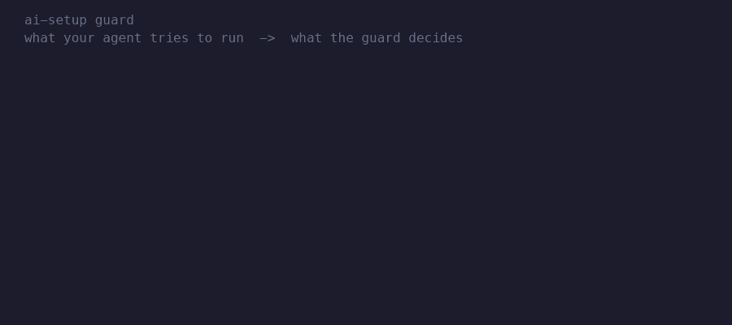

# ai-setup

[](https://github.com/sebabottero/ai-setup/actions/workflows/ci.yml)
[](https://github.com/sebabottero/ai-setup/actions/workflows/ci-macos.yml)
[](LICENSE)

**Make your AI coding agent ask before `git push`, `rm -rf` or reading your SSH keys, and stop burning tokens without noticing.**
One folder configures Claude Code, OpenCode and Codex the same way, on every machine.

```
Without ai-setup:  agent runs `git push --force origin main`  → done, no questions
With ai-setup:     agent runs `git push --force origin main`  → 🔴 "needs your explicit OK"
```



## See it work
The guard (a small script that checks every shell command the agent wants to run) on real commands:
```console
$ echo '{"tool":"bash","command":"git push origin main"}' | python3 core/guard/guard.py
{"decision": "ask", "reason": "🔴 high risk: 'git push origin main' needs your explicit OK (policy: git push *)"}
$ echo '{"tool":"bash","command":"git status"}' | python3 core/guard/guard.py
{"decision": "allow", "reason": ""}
```

**Try it in 30 seconds** (changes nothing):
```bash
git clone https://github.com/sebabottero/ai-setup.git ~/Dev/ai-setup && cd ~/Dev/ai-setup
./bootstrap.py --dry-run
```
Full steps in [Install](#install).

## What you get
| | |
|---|---|
| 🛡 **Asks before anything hard to undo** | One `policy.json` and one guard decide `allow` / `ask` / `deny` for every shell command. Secrets are a hard `deny`. Claude also gets an OS sandbox from the same policy. |
| 💸 **Spends fewer tokens** | `coach` picks model and effort before you start, and flags big PDFs/docs to convert first. A hook warns when the context passes 100k. `usage_report.py` audits your own sessions, locally. |
| 🔀 **Same rules in every tool** | Write rules, skills and agents once. They install into Claude Code, OpenCode and Codex. Your private bits live in layers (extra folders that add rules on top), not in a fork. |
| 🧱 **Repos that keep their rules** | `repo-guardrails` prepares any repo with a short `AGENTS.md`, a one-line `CLAUDE.md`, architecture tests that fail the build and a minimal CI. Only the file-scan test is verified; other languages are marked untested. |
| 🎫 **One writer per ticket** | `flow-ticket` plans, a single `sub-builder` writes in its own git worktree, and review, tests and checks run read-only in parallel. |
| 🔁 **A full cycle, not just tools** | Each of the 6 steps (decide → guardrails → build → independent review → human gate → learn) has a skill or a gate behind it. |

## How it decides
```
 agent runs a command
        │
        ▼
   guard.py (reads policy.json, composed into build/policy.json)
        ├─► allow ─► runs, no prompt          git status, ls, grep
        ├─► ask   ─► you approve, then runs   git push, git reset --hard, git clean
        └─► deny  ─► blocked                  .env.local, SSH and cloud credentials
        │
        ▼
   OS sandbox (Claude only): the wall if the guard misses something
```
The rules are plain JSON in [`core/policy.json`](core/policy.json) (shortened here):
```json
{
  "ask_commands":   ["git push *", "git reset --hard*", "git clean *"],
  "allow_commands": ["git status", "git diff *", "ls *"],
  "deny_files":     [".env.local", "*.env.local"],
  "deny_home_dirs": ["~/.ssh", "~/.aws"]
}
```
A layer can add rules, never weaken `core/`. More in [Reference](docs/REFERENCE.md).

## Measure it
The token audit on a month of real use (`python3 -I adapters/claude/usage_report.py 30`; reads only your local transcripts, sends nothing):
```console
Sessions: 149  |  over 150k: 35 (23%)  |  over 300k: 9  |  peak: 772k
Turns by model: claude-sonnet-5-5 60%, claude-opus-5-5 39%
Guard: 1233 allowed, 352 asked, 4 denied. Rules that fire most: outside-sandbox 123, git push * 80
```
`/coach` before a task (example): model and effort, plus your request rewritten as *goal · done when · out of scope · start from*.
Every ~30 days `tune-setup` re-tunes it from your own `/insights` data, and edits only after you approve.

`ai-audit` scores any repo, read-only, on how well it follows the cycle: `python3 -I core/skills/ai-audit/audit.py <repo>`.
Scores are 1-5 and heuristic. In one pilot the same cycle took four practices from weak to strong:
```console
Practice                  before → after
3 Enforced rules             1   →  4
4 Real static checks         1   →  5
5 Shared knowledge           2   →  5
7 CI covers what matters     2   →  5
```
Review, criteria-linked tests and the human gate stay at 1 there: `ai-audit` measures them over history, not one change. [The 6 steps, and what covers each](https://sebabottero.github.io/ai-setup/cheatsheet.html#cycle).

## Install
macOS with Homebrew and python3, or Linux with python3.
```bash
git clone https://github.com/sebabottero/ai-setup.git ~/Dev/ai-setup   # clone into the final path: the links point to it
cd ~/Dev/ai-setup
./bootstrap.py --dry-run     # shows what it would install, changes nothing
./bootstrap.py               # tools, then ./install.sh (runs the tests, backs up whatever it replaces)
```

## Is it for you?
**Yes** if you use an agent on real repos and want pushes, deletes and secret reads to need your OK, switch between agent tools,
work from tickets, or want to see and cut your token spend.
**Probably not** if you only run short throwaway scripts, need Windows, or expect a security boundary from the guard alone.

## Limits
- **A seatbelt, not a wall.** The guard cannot read a script file, a variable-built command or base64 (listed in `tests/test_guard.py`). The OS sandbox is the wall, Claude only. Found a bypass? Report it privately: see [SECURITY.md](SECURITY.md).
- **macOS first.** Linux works for the guard, installer and tests. No Windows. OpenCode uses a beta plugin API; Codex gets instructions and skills only.
- **No telemetry.** The guard keeps a local log without the command itself; `AI_SETUP_GUARD_LOG=off` disables it.

## More
[Reference](docs/REFERENCE.md) (layers, agents, adding rules, models, backup) · [Design notes](docs/DESIGN.md) · [Cheatsheet](https://sebabottero.github.io/ai-setup/cheatsheet.html) · [Security](SECURITY.md) · [Contributing](CONTRIBUTING.md)

## License
MIT. See `LICENSE`.
