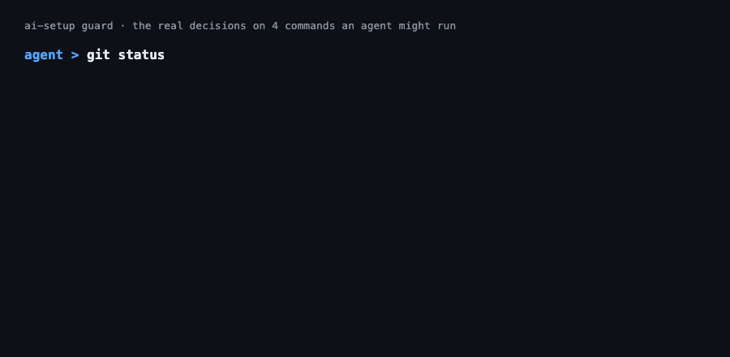

# ai-setup

[](https://github.com/sebabottero/ai-setup/actions/workflows/ci.yml)
[](https://github.com/sebabottero/ai-setup/actions/workflows/ci-macos.yml)
[](LICENSE)

**A local harness for AI coding agents: rules, a permission guard, a ticket-to-merge workflow, independent review and usage logs, around the agent you already use.**
One folder configures Claude Code, OpenCode and Codex the same way, on every machine. First proof: it makes the agent ask before `git push`, `rm -rf` or reading your SSH keys.

```
Without ai-setup:  agent runs `git push --force origin main`  → done, no questions
With ai-setup:     agent runs `git push --force origin main`  → 🔴 "needs your explicit OK"
```



## See it work
The guard (a small script that checks every shell command the agent wants to run) on real commands:
```console
$ echo '{"tool":"bash","command":"git push origin main"}' | python3 core/guard/guard.py
{"decision": "ask", "reason": "🔴 high risk: 'git push origin main' needs your explicit OK (policy: git push *)"}
$ echo '{"tool":"bash","command":"git status"}' | python3 core/guard/guard.py
{"decision": "allow", "reason": ""}
```

## How the guard decides
```
 agent runs a command
        │
        ▼
   guard.py (reads policy.json, composed into build/policy.json)
        ├─► allow ─► runs, no prompt          git status, ls, grep
        ├─► ask   ─► you approve, then runs   git push, git reset --hard, git clean
        └─► deny  ─► blocked                  .env.local, SSH and cloud credentials
        │
        ▼
   OS sandbox (Claude; OpenCode opt-in via srt): the wall if the guard misses something
```
The rules are plain JSON in [`core/policy.json`](core/policy.json) (shortened here):
```json
{
  "ask_commands":   ["git push *", "git reset --hard*", "git clean *"],
  "allow_commands": ["git status", "git diff *", "ls *"],
  "deny_files":     [".env.local", "*.env.local"],
  "deny_home_dirs": ["~/.ssh", "~/.aws"]
}
```
A layer can add rules, never weaken `core/`. More in [Reference](docs/REFERENCE.md).

## Install
macOS with Homebrew and python3, or Linux with python3.
```bash
git clone https://github.com/sebabottero/ai-setup.git ~/Dev/ai-setup   # clone into the final path: the links point to it
cd ~/Dev/ai-setup
./bootstrap.py --dry-run     # shows what it would install, changes nothing
./bootstrap.py               # tools, then ./install.sh (runs the tests, backs up whatever it replaces)
```

### OpenCode OS sandbox (opt-in)
OpenCode has no OS wall of its own, so by default it gets rules plus the guard only. To add one, install [`srt`](https://github.com/anthropic-experimental/sandbox-runtime) yourself (`npm install -g @anthropic-ai/sandbox-runtime`; ai-setup never installs it) and run:
```bash
./install.sh --opencode-sandbox   # writes ~/.ai-setup/opencode-sandbox.json and ~/.ai-setup/bin/opencode-sandboxed
~/.ai-setup/bin/opencode-sandboxed   # opencode inside srt, built from the same policy.json (srt settings unverified)
```
The settings reuse `policy.json` (allowed domains, `allow_write`, `work_dirs`, secrets, protected paths) and add what OpenCode needs because srt wraps the whole process: its state dirs (writable) and model-provider hosts, listed in `adapters/opencode/sandbox/extra.json` (edit it for the providers you use, then re-run the installer). The launcher adds the folder you start it from to the writable paths at launch. It is not identical to Claude's sandbox. Without the flag nothing is written and the install is unchanged. The srt settings format was written offline and is marked `TO VERIFY` in the launcher: check it against `srt --help` before trusting it.

## What you get
Eight layers of a harness, with an honest status. `done` means the evidence path exists on `main`; `partial` says what is missing.

| Layer | Status | Evidence | What is missing |
|---|---|---|---|
| Instructions | done | [`core/AGENTS.md`](core/AGENTS.md) | One set of rules and skills, installed into Claude Code, OpenCode and Codex (Codex: instructions and skills only). |
| Permissions / guard | done | [`core/guard/guard.py`](core/guard/guard.py) | `allow` / `ask` / `deny` from one `policy.json`; OS sandbox on Claude. OpenCode sandbox is opt-in and its srt settings are unverified. No scoped approvals by design ([DESIGN](docs/DESIGN.md)). |
| Workflow / agents | done | [`core/skills/ticket-flow/SKILL.md`](core/skills/ticket-flow/SKILL.md) | Ticket to merge, one writer per ticket, two human gates. |
| Review | done | [`core/agents/sub-review.md`](core/agents/sub-review.md) | Independent reviewer, findings table, round cap, history in `reviews.log`; optional second reviewer from another provider. |
| Verification | partial | [`core/agents/sub-review.md`](core/agents/sub-review.md) | One test per criterion and CI; the reviewer lists every criterion without a test as "not covered". Partial: an agent does it, not an automatic check. |
| Observability | partial | [`core/scripts/metrics.py`](core/scripts/metrics.py) | Sessions, guard ask rates, outcome of asks, tokens/turns/time per ticket (`usage_report.py --ticket`) and a weekly view (`metrics.py --week`). Partial: cost per ticket ignores subagent transcripts, so it is understated, and there is no real approval-rate data yet. |
| Knowledge | done | [`core/skills/session-handoff/SKILL.md`](core/skills/session-handoff/SKILL.md) | Handoffs, per-repo `AGENTS.md` via `repo-guardrails`, a repeated mistake becomes a rule (`meta-setup`, manual). |
| Recovery | partial | [`backup.sh`](backup.sh) | Backup of the setup and personal files, install backs up what it replaces. No rollback of an agent's edits to your repos. |

Also: `coach` picks model and effort before you start and a hook warns when the context passes 100k. See [The cycle](#the-cycle).

## The cycle
The guard is one piece. Around it, the whole loop of working with an AI agent, from ticket to merge:
```
 1 Decide ─► 2 Guardrails ─► 3 Build ─► 4 Independent ─► 5 Human ─► 6 Learn
                                          review          gate        │
   ▲                                                                  │
   └──────────────── a repeated mistake becomes a rule ◄──────────────┘
```
| # | Step | Covered by |
|---|---|---|
| 1 | **Decide** | `grillme` interviews you and writes `criteria.md`: goal, out of scope, done criteria, and `## Slices` when it should be several small PRs; `ticket-flow` Gate 1 shows a single-PR or split verdict |
| 2 | **Guardrails** | `repo-guardrails`: `AGENTS.md` templates (rules marked `E:` or with an expiry date), risk tiers, CI |
| 3 | **Build** | `ticket-flow` orchestrates, `sub-builder` writes, `sub-tester` writes one test per criterion |
| 4 | **Independent review** | `sub-review` checks the diff against `criteria.md`; the merge gate requires its report; `ticket-flow` re-reviews the committed PR against `criteria.md` and posts it as a PR comment only with your OK |
| 5 | **Human gate** | `ticket-flow` Gate 2 plus the guard's `ask` on commit, push and merge: you decide |
| 6 | **Learn** | `meta-setup` turns a repeated mistake into a rule; `ai-audit` is the periodic check |

Details per step in the [cheatsheet](https://sebabottero.github.io/ai-setup/cheatsheet.html#cycle).

## Measure it
A dated snapshot (2026-11-23) of real numbers from the author's machine. Each figure has the command that produced it; run it on your own logs.

**Rounds to PASS** (stage 3, diff review: rounds until `sub-review` first says PASS), from `~/Dev/logs/reviews.log`:
```console
$ awk -F'\t' '$5==3 && $6=="PASS" && !s[$3]++ {print $3, $4}' ~/Dev/logs/reviews.log
ai/harness-s1-review-history 2
ai/harness-s3-ask-baseline 2
ai/harness-s4-review-quality 1
ai/harness-s5-cost-weekly 2
ai/harness-s6-cross-reviewer 2
```
Clean: s3 2, s4 1, s5 2, s6 2 (4 branches, average 1.75). s1 is only a lower bound (logging started mid-review, its round 1 is missing). s2 and s7 have stage-4 rows only, so they are not comparable.

**Ask approval rate**: no real data yet. The outcome hook (approved / declined per ask) only just merged. Today `AI_SETUP_ACTIONS_LOG=~/Dev/logs/actions.log python3 -I adapters/claude/usage_report.py 30` prints:
```console
Approval rate: n/a (no decided asks); unknown 0, unresolved 1565 (of 1565 asks in the action log, ...)
```

**Asks and tokens** (`python3 -I adapters/claude/usage_report.py 30`, 2026-11-23; reads only your local files, sends nothing):
```console
Sessions: 338  |  over 150k: 44 (13%)  |  over 300k: 0  |  peak: 287k
Guard (last 30 days): 10101 allowed, 1528 asked, 46 denied. Rules that fire most: protected_paths 393, git push * 333, rm-outside-tmp 308
Ask rate per week (asks / guard decisions): 2026-W45 9% (208/2273), 2026-W46 11% (493/4423), 2026-W47 17% (660/3922), 2026-W48 16% (167/1057)
  guard.log only covers from 2026-11-03 on: earlier days and the first week are partial
```
Per ticket: `python3 -I adapters/claude/usage_report.py --ticket <slug>`; weekly file: `python3 core/scripts/metrics.py --week`.

`/coach` before a task (example): model and effort, plus your request rewritten as *goal · done when · out of scope · start from*.
Every ~30 days `tune-setup` (Claude only) re-tunes it from your own `/insights` data, and edits only after you approve.

`ai-audit` scores any repo, read-only, on how well it follows the cycle: `python3 -I core/skills/ai-audit/audit.py <repo>`.
Scores are 1-5 and heuristic; "Small changes" measures size per merged PR (per commit when there are no merge commits). In one pilot repo the same cycle took four practices from weak to strong:
```console
Practice                  before → after
3 Enforced rules             1   →  4
4 Real static checks         1   →  5
5 Shared knowledge           2   →  5
7 CI covers what matters     2   →  5
```
Review, criteria-linked tests and the human gate stay at 1 there: `ai-audit` measures them over history, not one change.

## Is it for you?
**Yes** if you use an agent on real repos and want pushes, deletes and secret reads to need your OK, switch between agent tools,
work from tickets, or want to see and cut your token spend.
**Probably not** if you only run short throwaway scripts, need Windows, or expect a security boundary from the guard alone.

## Limits
- **A seatbelt, not a wall.** The guard cannot read a script file, a variable-built command or base64 (listed in `tests/test_guard.py`). The OS sandbox is the wall: Claude gets it by default, OpenCode only with the opt-in below. Found a bypass? Report it privately: see [SECURITY.md](SECURITY.md).
- **macOS first.** Linux works for the guard, installer and tests. No Windows. OpenCode uses a beta plugin API; Codex gets instructions and skills only.
- **No telemetry.** The guard keeps a local log without the command itself; `AI_SETUP_GUARD_LOG=off` disables it.

## More
[Reference](docs/REFERENCE.md) (layers, agents, adding rules, models, backup) · [Design notes](docs/DESIGN.md) · [Recommended skills](docs/RECOMMENDED-SKILLS.md) · [Cheatsheet](https://sebabottero.github.io/ai-setup/cheatsheet.html) · [Security](SECURITY.md) · [Contributing](CONTRIBUTING.md)

## License
MIT. See `LICENSE`.
